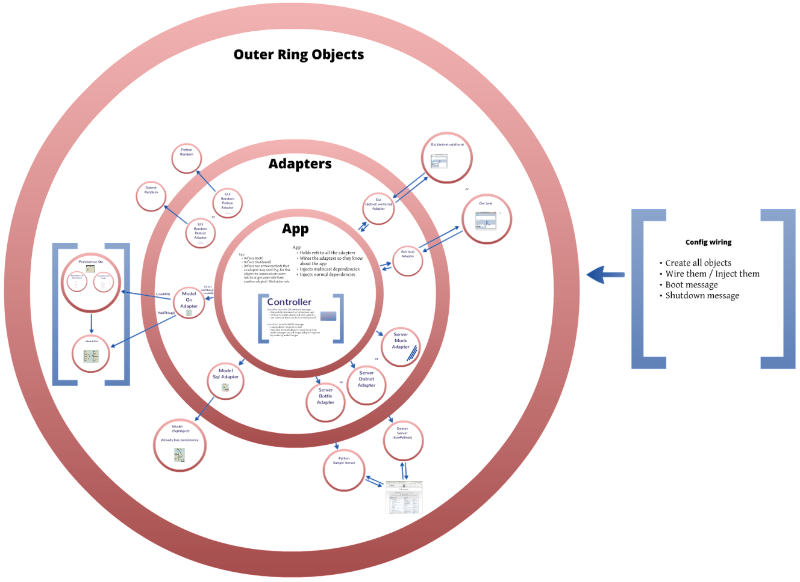
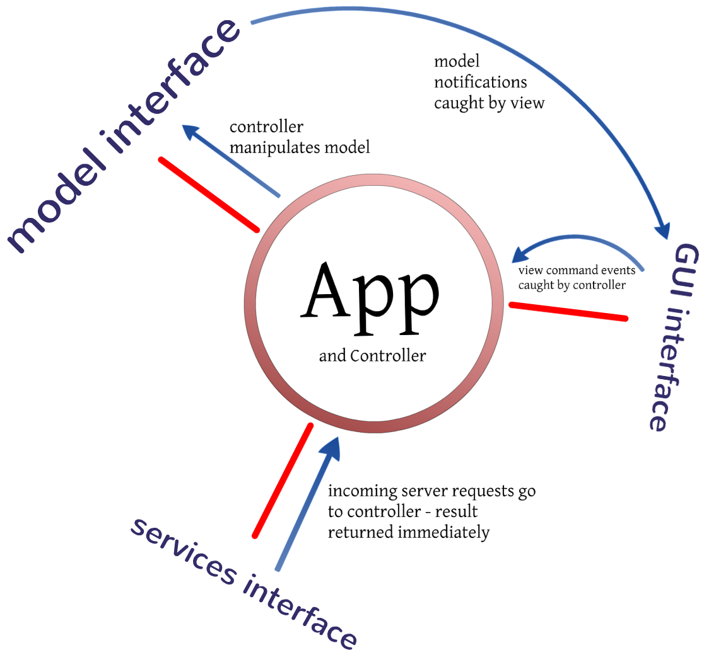
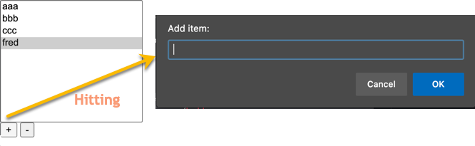

# HexMVC

Hexagonal Architecture + Model View Controller (MVC). A 2012 architectural pattern experiment by Andy Bulka.

> TLDR: Write the application layer but don't import or use any libraries directly. Wrap all "library" calls with Adapter objects, so that you can switch to other libraries easily.

> TLDR: "Libraries" can amazingly include the application data Model itself, database and persistence layers, the entire GUI, and all calls to server APIs. Plug and play everything.

Full article: https://abulka.github.io/patterns/hexmvc/

This repo is the original proof-of-concept code for that article. It needs no framework — the pattern is just a convention you can implement in any language.

## How it works

Central `App` hub (which owns the `Controller`) talks only to adapter interfaces. Concrete adapters orbit it in a ring and wrap the real implementations: GUI, Model, Server/services, plus small utility adapters (JSON, random, persistence).



Configuration/wiring is done outside `App` in a boot script: create the objects, inject them, send `Boot()`.

```python
# architecture3/AppMainConfigOo.py (shortened)
from ModelOo import Model
from ModelOoAdapter import ModelOoAdapter
from PersistenceOoHomegrown import Persistence
from ServerBottleAdapter import Server
from ViewWxAdapter import MyWxApp
import wx

model = ModelOoAdapter(Model(), Persistence())
server = Server(host='localhost', port=8081)
wxapp = MyWxApp(redirect=False)
gui = wxapp.myframe

app = App(model, server, gui)
wx.CallAfter(app.Boot)
wxapp.MainLoop()
```

Swap one line of the boot script and the rest of the app is none the wiser, e.g. `ServerBottleAdapter` → `ServerMockAdapter`, `ModelOoAdapter` → `ModelSqlObjectAdapter`, wxPython GUI → .NET WinForms GUI.

Eventing is simple multicast delegation, not a framework. `App` wires observers together (`lib/architecture_support.py:11`):

```python
gui.observers.addObserver(self.controller)
model.observers.addObserver(gui)
server.observers.addObserver(self.controller)
```

So view command events reach the controller, model notifications reach the view (and controller), and server requests call into the controller and return a result immediately:



Rules of thumb from the article:

- View layer notifies controller. Model layer usually notifies view directly.
- View can read the model, but only the controller modifies it.
- Model adapters own event broadcasting so models stay pure; view adapters own GUI-event → app-event translation (handy when the GUI is code-generated and can't be touched).
- Adapters may also talk to each other directly, but only through adapter interfaces.

## Demo

JavaScript Todo-list implementation of the same idea (from the article):



The Python demo is a "things" list app: wx GUI + Bottle REST server (`/things`, `/things/1`, `/modelsize`, `/dumpthings`) sharing one model.

## What's in this repo

`architecture3/` is the latest/canonical version. Everything else is earlier iterations and spikes.

| Path | What it is |
|---|---|
| `architecture3/` | Latest version. `App.py`, `Controller.py`, `ModelAdapterBase.py`, `ModelOo.py` / `ModelOoAdapter.py`, `ModelSql.py` / `ModelSqlAdapter.py`, `PersistenceOoHomegrown.py` / `PersistenceOoPickle.py`, `ServerBottleAdapter.py` / `ServerMockAdapter.py`, `ViewWx.py` + `ViewWxAdapter.py` (wxBuilder generated + inheriting mediator), `ViewWx.fbp`, `UtilJsonStdpythonAdapter.py`, `UtilRandomStdpythonAdapter.py`, boot configs `AppMainConfigOo.py` / `AppMainConfigSql.py`, Enterprise Architect model `arch3.eap`. |
| `architecture3/AppMainConfigDotnet/` | .NET port (IronPython + WinForms). Same `App`/adapter shape with `ServerDotnetAdapter.py`, `ViewDotnetWinFormAdapter.py`, `UtilJson/RandomDotnetAdapter.py`. |
| `hexagon3/` | Middle prototype. `hexagon1.py`, `hexagon2.py`, `hexagon3.py` show the boot wiring evolving; `hexapp.py`, `hexmodel_simple.py` / `hexmodel_sqlobject.py`, `hexserver.py`, `hexmvcgui.py`, `tests/test_hexmvc01.py`, Bottle views in `views/`. |
| `architecture2/` | Earliest sketch. `architecture1.py`, `architecture2.py`, wx FormBuilder files (`.fbp`, `architecture2_gui_gen.py`). Single-file exploration before the code was split into `Model*`, `Server*`, `View*` modules. |
| `puremv_minimal_to_hexmvc/` | PureMVC migration demo. `puremvcminimalwx0nostartupcmd.py` → `puremvcminimalwx1_puremvc_stripped_out.py` → `puremvcminimalwx2_as_hexmvc.py`: same minimal wx app with the PureMVC framework removed and replaced by ~a dozen lines of multicast wiring. |
| `lib/architecture_support.py` | `multicast` observer helper + small decorators. The only "framework" code. |
| `bottle tests/` | REST spikes (`bottle1.py`, `bottle3.py`, `flask1.py`). |
| `orm sqlobject test/`, `orm copycat test/` | Persistence spikes (SQLObject, Copycat). |
| `grand unified/` | Unrelated DuckDuckGo API snippet. |
| `doco/archive-Overview-of-HexMVC.txt` | Archived early working notes (archived Nov 2026; superseded by the article and this README). Kept for the persistence-design rationale and original bootstrap notes. |

Persistence note (from the archived overview, still relevant): the `ModelAdapter` interface stays generic (`LoadAll`/`SaveAll` take an optional filename only). DB-specific setup like connection strings belongs in the boot/wiring stage. SQL models auto-persist so their adapter's `LoadAll` is a no-op; OO models delegate to a separate `Persistence` object.

## Status / running it

Vintage 2012 code: Python 2 era, `wxPython`, `bottle`, `SQLObject`, wxBuilder-generated GUI code, and IronPython for the .NET port. Expect bit-rot — it likely needs tweaks to run on modern Python (imports, `print`, `_thread`, wx API changes). Start with `architecture3/AppMainConfigOo.py` and `hexagon3/tests/test_hexmvc01.py`.

## Further reading

- Main article: https://abulka.github.io/patterns/hexmvc/
- Adapters appendix: https://abulka.github.io/patterns/hexmvc-adapters/ (`content/patterns/hexmvc-adapters.md` in the blog repo)
- Related pages: eventing, scraps, MGM/MVCA pattern write-ups in the same blog section.
